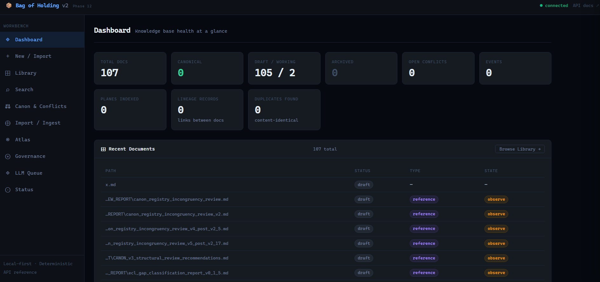
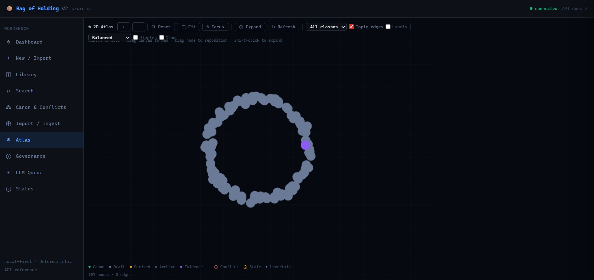

Bag of Holding keeps source documents, their authority, and their review history together. I built it around a problem I recognize from clinical operations: finding a document is only part of the work. Someone also needs to know whether it is current, what supports it, and who accepted it.

## What I built

A local FastAPI and SQLite workbench combines document intake, search, lifecycle transitions, relationship inspection, and human-reviewed AI proposals. Authority and review state are explicit data, with append-only history and reversible lifecycle actions.

The model can propose metadata. It cannot make a document canonical. An operator reviews the proposal, and the system records the outcome.

## Follow a document through the system

1. Import or write a document with source metadata.
2. Inspect its relationships, conflicts, and review status.
3. Review proposed changes before applying them.
4. Record an accepted transition while retaining the history.
5. Retrieve the document with its provenance and currentness visible.

The dashboard, library, and relationship view make that state inspectable. The screenshots on this page are retained captures from an earlier isolated demo. They show the interface, not newly captured acceptance evidence for the latest source update.

## The public and private boundary

The public repository is a sanitized source export. It includes portable application code, demo material, and a public test inventory. Private corpora, runtime databases, credentials, operational MCP deployment, and other-project integration tooling remain outside it.

The [public update and verification boundary](https://github.com/ppeck1/Bag-of-Holding/blob/main/docs/PUBLIC_UPDATE_2026_10.md#verification-boundary) identify what is included and what remains private. Public CI reports the exported suite's result; counts from the complete private system are not public test results.

## What this demonstrates

- A data model that separates document content from accepted authority.
- Human review enforced at the write boundary.
- Search and retrieval that retain provenance and freshness information.
- A deliberate, documented split between reusable source and operational data.

## Current limits

This remains a local development platform. Clean-machine packaging, remote tenant isolation, large-corpus performance, general passage relevance, and unattended operation have not been qualified. PDF/image OCR is unavailable. The retained screenshots do not establish those capabilities.

## Explore

- [Repository and current quickstart](https://github.com/ppeck1/Bag-of-Holding)
- [Public export manifest](https://github.com/ppeck1/Bag-of-Holding/blob/main/PUBLIC_EXPORT_MANIFEST.txt)
- [Public verification details](https://github.com/ppeck1/Bag-of-Holding/blob/main/docs/PUBLIC_UPDATE_2026_10.md)
